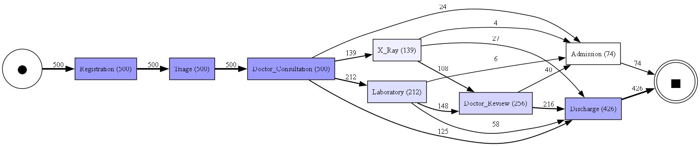
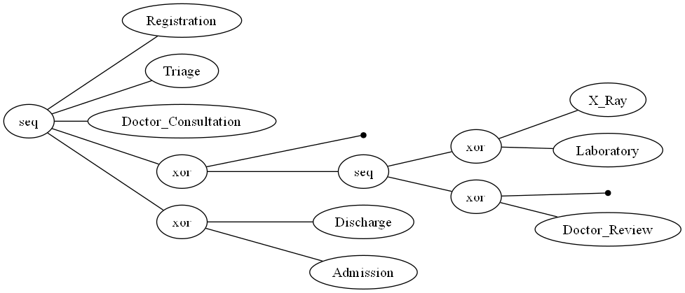

# CareFlow — Clinical Pathway Process Mining

CareFlow is a hospital process-mining and analytics project that uses **simulated patient event data** to study clinical pathways, patient waiting time, and operational bottlenecks. The project combines Python-based event-log analysis, PM4Py process discovery, validation checks, and an interactive Power BI dashboard.

> **Data note:** All patient data used in this project is simulated. The findings are descriptive and should not be interpreted as evidence about a real hospital.

## Project Objectives

- Prepare and validate a timestamp-based patient event log.
- Understand how patients move through hospital activities.
- Discover common clinical pathways using PM4Py.
- Measure waiting time before doctor consultation and gaps between activities.
- Explore doctor availability, queue size, and operational bottlenecks.
- Present key findings through an interactive Power BI dashboard.

## Dataset Overview

The analysis uses a simulated dataset containing:

| Metric | Count |
|---|---:|
| Patient cases | 500 |
| Patient events | 2,607 |
| Discharged cases | 426 |
| Admitted cases | 74 |

The event log includes fields such as `Case_ID`, `Activity_Name`, `Timestamp`, `Doctor_ID`, `Department`, previous-activity details, and calculated time gaps.

## Tools and Technologies

- **Python** — analysis and data preparation
- **pandas, NumPy** — data manipulation
- **PM4Py** — process discovery and process mining
- **Matplotlib / Graphviz** — process visualizations
- **Jupyter Notebook** — analysis workflow
- **Microsoft Power BI** — interactive dashboard
- **Git and GitHub** — version control and project collaboration

## Project Workflow

1. **Data preparation:** Clean and organize simulated patient event records.
2. **Event-log validation:** Check timestamps, activity order, previous-event details, and calculated gaps.
3. **Process discovery:** Use PM4Py to generate a Directly-Follows Graph (DFG) and a Process Tree.
4. **Delay analysis:** Examine triage-to-doctor waiting time and event-to-event time gaps.
5. **Bottleneck analysis:** Review admission, laboratory, X-Ray, consultation, doctor workload, and queue-related measures.
6. **Conformance audit:** Apply rule-based checks to the expected patient pathway.
7. **Dashboard development:** Present the analysis in Power BI.

## Process Discovery

PM4Py was used to discover the process structure from the patient event log.

### Directly-Follows Graph

The DFG represents the directly-following relationships between hospital activities.

### Process Tree

The process tree provides a structured representation of the discovered workflow.

## Key Analysis Findings

### Doctor Consultation Waiting Time

| Measure | Result |
|---|---:|
| Average waiting time | 31.21 minutes |
| Median waiting time | 29 minutes |
| Maximum observed waiting time | 102 minutes |
| Patients waiting more than 30 minutes | 233 (46.6%) |
| Patients waiting more than 45 minutes | 68 (13.6%) |

### Patient Journey Duration

| Patient outcome | Average journey duration |
|---|---:|
| Discharged | 105.46 minutes |
| Admitted | 127.58 minutes |
| Overall | 108.73 minutes |

### Patient Pathways

The most frequent observed pathways include:

- Laboratory → Doctor Review → Discharge: 129 cases
- Direct Discharge: 125 cases
- X-Ray → Doctor Review → Discharge: 87 cases
- Laboratory → Discharge: 58 cases
- X-Ray → Discharge: 27 cases

### Bottleneck Analysis

The analysis highlighted admission processing as a high-priority area for review. Laboratory, X-Ray, and doctor consultation were identified as medium-priority areas, while doctor review was classified as lower priority in the current analysis.

These categories are analytical priorities based on the simulated dataset; they do not establish the cause of a delay.

## Data Validation and Conformance Audit

The pipeline checks include:

- Chronological ordering of timestamps within each patient case.
- Validation of activity sequences and previous-event details.
- Verification of calculated time gaps.
- Checks for required event-log fields.

A rule-based patient pathway audit was performed on all 500 cases. **All 500 cases passed the five configured checks**, covering registration start, triage before doctor consultation, valid final outcome, chronological timestamps, and consecutive duplicate activities.

This is a rule-based validation audit, not a formal PM4Py model-conformance measurement.

## Power BI Dashboard

The interactive Power BI report is organized into five pages:

1. **Hospital Overview** — overall patient and outcome summary.
2. **Patient Journey Analysis** — patient pathways and journey duration.
3. **Waiting Time Analysis** — consultation waiting-time distribution and delays.
4. **Bottleneck Analysis** — activity-wise gaps and bottleneck indicators.
5. **Doctor and Queue Analysis** — doctor workload, availability, and queue patterns.

The report includes visual summaries and interactive filtering to explore the simulated hospital data.

## Repository Contents

| File | Description |
|---|---|
| `healthcare_project.ipynb` | Main Python analysis notebook |
| `events_clean.csv` | Cleaned patient event log |
| `CareFlow_Dashboard.pbix` | Power BI dashboard |
| `careflow_dfg.png` | Directly-Follows Graph |
| `careflow_process_tree.png` | Discovered Process Tree |
| `careflow_delay_analysis.csv` | Patient-level delay analysis |
| `careflow_waiting_summary.csv` | Waiting-time category summary |
| `top_10_waiting_cases.csv` | Ten longest consultation waits |
| `careflow_doctor_waiting_analysis.csv` | Doctor waiting-time analysis |
| `careflow_bottleneck_analysis.csv` | Activity bottleneck analysis |
| `careflow_admission_bottleneck_summary.csv` | Admission bottleneck summary |
| `careflow_top_delay_events.csv` | Highest-delay event records |
| `careflow_pipeline_audit.csv` | Pipeline validation summary |
| `careflow_conformance_audit.csv` | Case-level pathway audit results |

Progress notes are also maintained in `CAREFLOW_PROGRESS.md` and `POWER_BI_PROGRESS.md`.

## Limitations and Future Improvements

- The dataset is simulated and may not reflect real hospital operations.
- Observed associations do not prove that doctor availability, queue size, or any single factor caused a delay.
- Activity-to-activity time gaps should not automatically be interpreted as actual patient waiting time.
- Further work could include more detailed resource analysis, additional process-mining metrics, and validation using real, appropriately governed data.
- BigQuery and dbt integration are not part of the current implemented workflow.

## Conclusion

CareFlow demonstrates how event-log preparation, process mining, time-based analysis, validation, and dashboarding can be combined to explore patient journeys and operational delays. The project provides a reproducible analytical view of simulated hospital workflows and highlights areas that may deserve further investigation.
